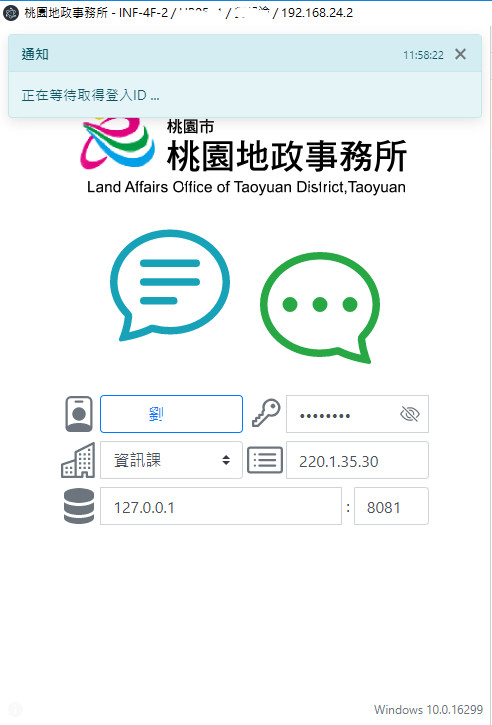

# 桃園地政信差服務即時通 (lah-messenger)

<div class="text-center"></div>

本專案為桃園市各地政事務所內部公務即時通訊桌面客戶端。  
目前位於 **`rust-migration`** 分支，正在進行底層自 Electron 遷移至 **Rust + Tauri v2** 的工程，在大幅減少記憶體占用、縮減安裝體積與提升啟動速度的同時，維持既有 Nuxt 2 (Vue 2 + BootstrapVue) 介面與功能 100% 相容。

---

## 快速上手與開發指南

### 1. 系統環境準備

在開始編譯與開發前，請先執行工作區提供的自動化診斷腳本：

```powershell
# 執行環境診斷（檢查 Rust、MSVC C++ Build Tools、WebView2 與 Node.js）
.\setup_rust_env.ps1
```

- **Node.js**：推薦 Node.js 18.x ~ 22.x（本機支援）
- **Rust 工具鏈**：需安裝 Rustup (`stable-x86_64-pc-windows-msvc`)，可至 [rustup.rs](https://rustup.rs/) 下載安裝
- **C++ 建置工具**：需具備 Visual Studio C++ Build Tools (MSVC)
- **WebView2 Runtime**：Windows 10 / 11 系統預設皆已內建

---

### 2. 安裝相依套件

```bash
# 進入專案目錄
cd lah-messenger

# 安裝前端與建置工具套件
npm install
# 或使用 yarn
yarn install
```

---

### 3. 開發模式啟動 (Tauri + Nuxt)

```bash
# 啟動 Tauri v2 開發熱重載（Nuxt 前端伺服器 :8888 + Rust 桌面應用）
npm run tauri:dev
# 或使用 yarn
yarn tauri:dev
```

> **注意**：首次執行會由 Cargo 自動下載 Rust 依賴 crates 並編譯底層模組，後續啟動將非常快速。

---

### 4. 正式打包建置 (Production Build)

```bash
# 一鍵打包 Windows 應用（產出可攜版 Portable .exe 與 NSIS 安裝精靈）
npm run tauri:build
# 或使用 yarn
yarn tauri:build
```

- 打包完成後，發布產物會自動提取並清理置放於專案根目錄的 **`dist/`**：
  1. **標準 NSIS 安裝包**：`dist/桃園地政信差服務即時通_1.6.0_x64-setup.exe`（支援雙擊全自動安裝到底，免手動點擊下一步）
  2. **可攜獨立執行檔**（Rust 目錄備援）：`src-tauri/target/release/lah-messenger.exe`（直接覆蓋更新或綠色執行）

---

### 5. 既有 Electron 模式（相容性對照）

若需對照原 Electron 版本的執行行為：

```bash
# Electron 開發模式 (Nuxtron)
npm run dev

# Electron Windows 打包
npm run build:win
```

---

## 測試與驗證

### A. Rust 底層模組靜態檢查與測試

```bash
# 切換至 Rust 核心目錄
cd src-tauri

# 檢查 Rust 語法與型別相容性
cargo check

# 執行 Rust 單元測試
cargo test
```

### B. Nuxt 前端靜態生成測試

```bash
# 測試 Nuxt 靜態網站產出 (輸出至 renderer/dist)
npm run generate:nuxt
```

### C. 執行環境診斷確認

```powershell
pwsh .\setup_rust_env.ps1
```

---

## 架構說明 (Architecture)

```text
lah-messenger/
├── src-tauri/                  # [新增] Rust + Tauri v2 桌面核心底層
│   ├── Cargo.toml              # Rust 套件依賴 (tauri v2, ldap3, sysinfo, etc.)
│   ├── tauri.conf.json         # Tauri 視窗尺寸 (490x740)、Tray、權限與打包設定
│   ├── capabilities/           # Tauri v2 模組化安全權限清單
│   └── src/
│       ├── main.rs             # 應用生命週期、單一執行個體鎖定、事件轉發
│       ├── tray.rs             # 系統匣 (Tray) 選單、雙擊/單擊切換與未讀訊息閃爍
│       └── commands/           # 原生系統 IPC Commands
│           ├── ad.rs           # Active Directory LDAP 查詢與課室群組分類 (ldap3)
│           ├── sysinfo.rs      # 主機/帳號/OS 資訊與 192.168.10.x~89.x 網段優先排序
│           ├── explorer.rs     # 檔案與目錄開啟容錯機制、Base64 暫存圖片檢視
│           └── window.rs       # 視窗顯示、標題管理、桌面通知與訊息對話框
├── renderer/                   # Nuxt 2 (Vue 2 + BootstrapVue) 前端渲染層
│   ├── plugins/
│   │   └── electron-shim.js    # [新增] IPC 橋接層：透明將 ipcRenderer 轉接至 Tauri
│   ├── components/             # 即時通 Vue 元件群 (chat-board, message, user-card 等)
│   ├── pages/                  # 頁面 (home.vue, settings.vue)
│   └── nuxt.config.js          # Webpack Alias 配置，將 'electron' 指向 electron-shim
├── main/                       # (原 Electron 主進程，保留作為對照與平滑相容備用)
└── setup_rust_env.ps1          # 本機環境診斷與自動化引導腳本
```

---

## 關鍵技術特性

1. **零改動前端橋接 (IPC Shim)**：  
   透過 `renderer/plugins/electron-shim.js`，現有 18+ 個 Vue 元件中使用之 `const { ipcRenderer } = require('electron')` 與 `ipcRenderer.invoke(...)` 完全不需改寫，由 Webpack Alias 攔截並轉發至 Tauri 的 `invoke` 與 `listen`。
2. **純 Rust 非同步 LDAP (`ldap3`)**：  
   原生與 Windows AD Domain Controller 進行 Simple Bind 與組織群組比對，不需依賴外部 Node 原生模組。
3. **作業系統視窗約束**：  
   嚴格鎖定主視窗 490×740 固定尺寸，關閉視窗自動退回系統匣（Tray）維持常駐，支援 Windows 工作列通知閃爍與未讀訊息提示。

---

## 版本修改歷程 (Changelog)

詳細版本歷程與各項更新說明請參閱 [CHANGELOG.md](CHANGELOG.md)。
