# 首頁架構與模組設計規格書 (`home.vue`)

> **檔案位置**：`lah-messenger/renderer/pages/home.vue`  
> **適用版本**：v1.6.0+（Rust + Tauri v2 & Nuxt 2 模組化重構架構）  
> **最後更新**：2026-10-25

---

## 1. 系統定位與架構視野

[home.vue](file:///c:/Temp/DEV/LAH-Workspace/lah-messenger/renderer/pages/home.vue) 是桃園即時通桌面客戶端前端渲染層（Renderer Process）的核心主頁面容器。本頁面採用 **Nuxt 2 (Vue 2.x Options API)** 開發，模板使用 **Pug** 語法搭配 **BootstrapVue 2.18.1** UI 元件庫。

在經過模組化重構後，[home.vue](file:///c:/Temp/DEV/LAH-Workspace/lah-messenger/renderer/pages/home.vue) 扮演「高層組裝容器（Page Orchestrator）」角色，將原先超過 1,800 行的臃腫單檔架構，依據 `principle-minimize-reader-load` 原則拆分為 **頁面容器（540 行）**、**獨立子元件（home-login.vue）** 與 **5 大專責業務 Mixins**，達成職責解耦、結構清晰且功能 100% 照舊相容的目標。

---

## 2. 系統架構拓撲圖 (Architecture Topology)

```mermaid
flowchart TD
    subgraph Host["主頁面容器 (Page Container)"]
        HOME["home.vue<br/>(頁面佈局 / 快捷鍵 / 生命週期組裝)"]
    end

    subgraph SubComponents["子視圖元件 (Sub-components)"]
        LOGIN["components/home-login.vue<br/>(未連線登入介面 / 管理者認證)"]
        BOARD_MSG["components/message-board.vue<br/>(訊息看板列表)"]
        BOARD_CHAT["components/chat-board.vue<br/>(聊天頻道列表)"]
        STATUS["components/status.vue<br/>(右下角狀態列)"]
        AVATAR["components/user-avatar.vue<br/>(線上成員頭像)"]
        HISTORY["components/input-history.vue<br/>(訊息歷史快捷選單)"]
    end

    subgraph Mixins["業務邏輯模組層 (Domain Mixins)"]
        WS["mixins/home-ws.js<br/>(WebSocket 通訊 / 重連 / ACK 分派)"]
        AUTH["mixins/home-auth.js<br/>(使用者身分 / AD 查詢 / API 同步)"]
        DESKTOP["mixins/home-desktop.js<br/>(IPC 監聽 / 視窗標題 / 工作列閃爍)"]
        INPUT["mixins/home-input.js<br/>(輸入草稿 / 附件上傳 / 預覽發送)"]
        QUEUE["mixins/home-status-queue.js<br/>(狀態訊息排程佇列)"]
        HIST_MIXIN["mixins/input-history.js<br/>(歷史輸入快顯共用邏輯)"]
    end

    HOME --> LOGIN
    HOME --> BOARD_MSG
    HOME --> BOARD_CHAT
    HOME --> STATUS
    HOME --> AVATAR
    HOME --> HISTORY

    HOME -. "mixins 混入" .-> WS
    HOME -. "mixins 混入" .-> AUTH
    HOME -. "mixins 混入" .-> DESKTOP
    HOME -. "mixins 混入" .-> INPUT
    HOME -. "mixins 混入" .-> QUEUE
    HOME -. "mixins 混入" .-> HIST_MIXIN
```



---

## 3. 雙態生命週期與視圖渲染

[home.vue](file:///c:/Temp/DEV/LAH-Workspace/lah-messenger/renderer/pages/home.vue) 透過全域 Vuex 狀態中的 `connected` 旗標嚴格區分兩種應用運作狀態：

### 3.1 未連線狀態 (`v-else`：登入與身分認證)
當客戶端尚未與即時通伺服器建立 WebSocket 長連線時，由 [home-login.vue](file:///c:/Temp/DEV/LAH-Workspace/lah-messenger/renderer/components/home-login.vue) 子元件完全接管渲染：
- **一般同仁智慧登入卡片**：呈現本機自動偵測之網域帳號、姓名、頭像縮寫、所屬課室鎖定標籤與伺服器連線狀態，點擊「進入即時通」即可直接發起連線。
- **管理者手動登入模式**：支援切換至 [admin-manual-login.vue](file:///c:/Temp/DEV/LAH-Workspace/lah-messenger/renderer/components/admin-manual-login.vue)，手動輸入伺服器 IP、Port、帳號、姓名與課室。
- **管理者身分驗證 Modal (`#admin-auth-modal`)**：點擊防護盾圖示或連點桃園市 Logo 5 次觸發，需輸入指定管理通行碼（`033695588`）授權進入手動模式。

### 3.2 已連線狀態 (`v-if="connected"`：主聊天介面)
當 WebSocket 連線成功並完成交握後，進入主應用介面：
1. **頂部導覽頁籤 (`b-nav`)**：
   - **📣 公告 (`announcement`)**：全所公務公告，具備未讀紅點計數。
   - **💬 通知 (`chat`)**：各課室頻道與自訂群組看板列表，具備未讀計數。
   - **📧 私訊 (`userid`)**：個人一對一私訊頻道。
   - **⚙️ 設定**：跳轉至 `/settings` 設定頁面。
2. **聊天控制列 (`inChatting`)**：進入特定對話室時顯示，具備「返回頻道列表」按鈕與該頻道線上成員之動態重疊頭像組 (`user-avatar`)。
3. **主內容看板**：
   - [chat-board.vue](file:///c:/Temp/DEV/LAH-Workspace/lah-messenger/renderer/components/chat-board.vue)：頻道列表。
   - [message-board.vue](file:///c:/Temp/DEV/LAH-Workspace/lah-messenger/renderer/components/message-board.vue)：對話或公告內容清單，支援回覆、撤回與檢視附件。
4. **底部訊息輸入工具列 (`showInputGroup`)**：
   - 具備 `b-textarea`（支援 Enter+Ctrl/Shift 送出、Esc 清除）。
   - 快捷鍵向上鍵快顯歷史訊息選單 ([input-history.vue](file:///c:/Temp/DEV/LAH-Workspace/lah-messenger/renderer/components/input-history.vue))。
   - 表情符號挑選 ([emoji-pickup.vue](file:///c:/Temp/DEV/LAH-Workspace/lah-messenger/renderer/components/emoji-pickup.vue))。
   - 圖片上傳 ([image-upload.vue](file:///c:/Temp/DEV/LAH-Workspace/lah-messenger/renderer/components/image-upload.vue))。
   - 檔案附件選取（嚴格限制合規公務格式與 10MB 大小）。
   - 浮動即時預覽框 (`.float-preview`)。

---

## 4. 模組化職責與 API 詳細清單

### 4.1 主頁面容器：[home.vue](file:///c:/Temp/DEV/LAH-Workspace/lah-messenger/renderer/pages/home.vue) (約 540 行)
- **職責**：頁面框架排版、Flexbox 佈局約束、全域快捷鍵監聽與視窗生命週期調度。
- **專屬狀態 (`data`)**：
  - `currentFontSize`: 記錄當前字體縮放設定（`normal` / `medium` / `large`）。
  - `back`, `keyCodes`: 鍵盤輸入歷史陣列（用於彩蛋比對）。
- **專屬計算屬性 (`computed`)**：
  - `isChat`, `isPersonal`, `isAnnouncement`, `isInf`, `isAdm`, `isVal`, `isReg`, `isSur`, `isAcc`, `isHr`, `isSupervisor`, `isLds`: 頻道識別判斷。
  - `maxUnwrappedAvatars`, `connectedUsersOverlapRatio`: 線上成員頭像群自動壓縮與重疊比例計算。
  - `showInputGroup`, `showMessageBoard`, `showChatBoard`, `inChatting`: 視圖切換邏輯。
  - `list`, `stickyChannels`: 目前頻道訊息清單與常駐頻道定義。
- **專屬方法 (`methods`)**：
  - `keydown(e)`: 鍵盤事件監聽，記錄最近 10 次按鍵代碼。
  - `handleKonamiCode()`: MD5 雜湊比對隱藏指令，切換管理者權限。
  - `visibilityChange()`: 視窗可見性變更時同步工作列閃爍。
  - `watchModal(e, id)`: 監聽 Modal 開啟/關閉，適時暫停或恢復重連計時器。
- **生命週期鉤子 (`lifecycle`)**：
  - `created()`: 註冊當前頻道、初始化 IPC 監聽、發起本機 userinfo 查詢。
  - `mounted()`: 防抖函式綁定、回復本機快取設定 (`restoreSettings`)、掛載鍵盤/貼上/焦點監聽器、通知 Tauri 原生層 `home-ready`。
  - `beforeDestroy()`: 停止重連定時器、關閉 WebSocket、移除全部全域監聽器。

---

### 4.2 登入子元件：[home-login.vue](file:///c:/Temp/DEV/LAH-Workspace/lah-messenger/renderer/components/home-login.vue) (約 150 行)
- **職責**：未連線登入畫面渲染、卡片 UI、管理者手動登入切換、通行碼驗證對話框與 Scoped CSS。
- **屬性 (`props`)**：
  - `manualLogin`: 是否處於手動登入模式（支援 `.sync` 雙向綁定）。
  - `adAccount`, `adName`, `department`, `deptName`, `avatarText`: 使用者身分相關資訊。
  - `validHost`, `wsHost`, `wsPort`, `connecting`, `validInformation`: 連線與伺服器檢驗狀態。
  - `isAdmin`: 是否已取得管理者權限。
- **對外事件 (`events`)**：
  - `@enter`: 點擊「進入即時通」時觸發連線流程。
  - `@admin-connect`: 手動模式填寫完畢送出時觸發。
  - `@update:manualLogin`: 變更手動模式狀態。

---

### 4.3 WebSocket 通訊核心：[home-ws.js](file:///c:/Temp/DEV/LAH-Workspace/lah-messenger/renderer/mixins/home-ws.js) (約 460 行)
- **職責**：WebSocket 連線生命週期維持、自動重連退避排程、ACK 回執分派、伺服器廣播事件處理與頻道未讀計數。
- **狀態與計算屬性**：
  - `wsHost`, `wsPort`, `connecting`, `reconnectMs`, `checkUnreadTimer`: 連線參數與定時器。
  - `wsConnStr`, `validHost`, `validPort`, `showUnreadChannels`, `chatUnread`, `showChatUnread`, `notifyChannels`: 通訊端點與頻道統計計算。
- **核心方法**：
  - `connect()`: 建立 WebSocket 連線，掛載 `onopen`, `onclose`, `onerror`, `onmessage`。
  - `handleWebSocketMessage(e)`: 訊息主分發路由器（區分 `ack`、`system`、當前頻道、背景頻道）。
  - `handleAckMessage(json)`: 處理 `register`, `mychannel`, `remove_channel`, `remove_message`, `edit_message`, `previous`, `unread`, `online`, `private_message`, `attachment_uploaded`, `attachment_deleted`, `set_read`, `check_read`, `update_current_channel`。
  - `handleSystemMessage(json)`: 處理全域使用者異動廣播 (`update_user`, `user_connected`, `user_disconnected`, `user_channel_changed`)。
  - `handleCreatedMessageForUpload(channel, messageId)`: 關聯待上傳之本機檔案至伺服器已建立之訊息 ID。
  - `register()`, `latestMessage()`, `sendChannelUpdate(channel)`: 標準協定發送封裝。
  - `resetReconnectTimer()`, `queryUnreadCount()`, `queryChannelUnreadCount(c)`: 背景巡檢與重連。

---

### 4.4 身分認證與 API 同步：[home-auth.js](file:///c:/Temp/DEV/LAH-Workspace/lah-messenger/renderer/mixins/home-auth.js) (約 390 行)
- **職責**：Active Directory 認證查詢、後端 RESTful API 使用者快取同步、課室鎖定規則判斷與智慧自動登入排程。
- **狀態與計算屬性**：
  - `adHost`, `adAccount`, `adName`, `adPassword`, `department`, `departmentOpts`, `manualLogin`, `autoConnectTimer`, `adQuerying`。
  - `avatarText`, `deptName`, `userQueryStr`, `validAdHost`, `validAdAccount`, `validAdName`, `validAdPassword`, `validDepartment`, `validInformation`, `disabledAdLoginBtn`, `queryADVariant`。
- **核心方法**：
  - `queryUserInfo()`: 自本機原生獲取登入者環境資訊 (`ipcRenderer.invoke('userinfo')`)。
  - `setUserInfo(u)`: 智慧姓名解析（優先順序：Windows realname -> 員工對照表 -> 預設名稱）並更新 Vuex/LocalForage。
  - `loadApiUserData()`, `loadApiADUserData()`, `loadUserMapData()`: 透過 HTTP POST 呼叫後端 API 取得權限清單、組織結構與全所員工代碼對照表。
  - `triggerAutoConnect()`: 當資訊完整時，延遲 1.2 秒自動啟動登入，提供同仁免操作體驗。
  - `handleAdminConnect(info)`, `handleManualEnter()`: 手動操作與進入處理。
  - `getDepartmentName(v)`, `refreshApiDepartment(v)`, `handleApiUserInfoUpdate(v)`: 課室名稱代碼雙向轉換。
  - `restoreSettings()`: 本機字體大小、伺服器 IP/Port 設定還原。

---

### 4.5 桌面 IPC 與通知控制：[home-desktop.js](file:///c:/Temp/DEV/LAH-Workspace/lah-messenger/renderer/mixins/home-desktop.js) (約 120 行)
- **職責**：原生 Electron / Tauri IPC 通訊轉發、未讀訊息計數托盤圖示紅點切換、Windows 工作列橘色閃爍與視窗標題更新。
- **核心邏輯**：
  - `totalUnread` 偵聽器：未讀數大於 0 時通知原生端切換通知圖示（`message_notice.ico`），若視窗非處於前景則觸發工作列閃爍 (`flash-frame`)。
  - `updateWindowTitle()`: 組合「IP / 姓名 / 課室」動態呼叫 `ipcRenderer.invoke('title', titleStr)` 更新原生視窗標題列。
  - `ipcRendererSetup()`: 註冊原生通道監聽（`set-current-channel`, `in-browser-notify`）。
  - `triggerNotification(incoming)`, `invokeNotification(i)`: 收到新訊息時過濾自己、解析內容並更新狀態列文字。
  - `onWindowFocus()`, `onWindowBlur()`: 視窗焦點進出控制閃爍熄滅或重新排程。
  - `checkUnread()`: 定期背景檢查未讀通知。

---

### 4.6 底部輸入與多媒體發送：[home-input.js](file:///c:/Temp/DEV/LAH-Workspace/lah-messenger/renderer/mixins/home-input.js) (約 220 行)
- **職責**：訊息輸入框狀態管理、剪貼簿貼圖偵測、合規公務附件防呆上傳、Markdown 即時預覽與訊息發送。
- **狀態與計算屬性**：
  - `inputText`, `inputImages`, `uploadFiles`, `emoji`。
  - `valid`, `markdImages`, `markdMessage`, `messagePreviewJson`。
- **核心方法**：
  - `protectLocalPath(text)`: 本機與網路路徑保護（自動以反引號標註防止被 Markdown 解析破壞）。
  - `handleFileChange(e)`: 選取檔案時立即執行 `validateAttachmentFile` 前置防呆檢驗（副檔名白名單與單檔 10MB 上限），違規時阻擋並彈出 [showAttachmentError](file:///c:/Temp/DEV/LAH-Workspace/lah-messenger/renderer/plugins/global-vue-mixin.js) 詳細說明。
  - `onWindowPaste(event)`, `pasted(base64)`: 攔截 Ctrl+V 圖片貼上，自動轉為 Base64 預覽縮圖。
  - `emojiPickup()`, `addEmoji(emoji)`: 表情符號插入與游標位置計算。
  - `pick()`: 彈出直接傳送圖片對話框 ([image-upload.vue](file:///c:/Temp/DEV/LAH-Workspace/lah-messenger/renderer/components/image-upload.vue))。
  - `reply(raw)`: 快速引用回覆特定訊息。
  - `send()`, `sendTo(msg, opts)`: 封裝發送至目標頻道，若帶有附件則提交待處理佇列並重置輸入狀態。

---

### 4.7 狀態文字排程佇列：[home-status-queue.js](file:///c:/Temp/DEV/LAH-Workspace/lah-messenger/renderer/mixins/home-status-queue.js) (約 35 行)
- **職責**：右下角狀態列 ([status.vue](file:///c:/Temp/DEV/LAH-Workspace/lah-messenger/renderer/components/status.vue)) 訊息佇列管理，避免多個狀態事件同時觸發造成文字閃爍。
- **核心方法**：
  - `setConnectText(text)`: 推入訊息至佇列（上限 10 筆）。
  - `processQueue()`: 依序取出並設定顯示，每則訊息固定停留 1 秒後銜接下一筆。

---

## 5. 開發與維護注意事項

1. **嚴格禁止任意破壞樣式約束**：
   - [home.vue](file:///c:/Temp/DEV/LAH-Workspace/lah-messenger/renderer/pages/home.vue) 中的 `.main-layout` 與 `::v-deep .scrollable-board` 樣式是經過字體放大與視窗鎖定嚴格計算的最佳解（`calc(100vh - 1.85rem)`），切勿隨意改動父容器高度，以免造成底部狀態列重疊遮蔽或對話清單捲動失效。
2. **Mixin 狀態命名唯一性**：
   - 所有混入的 Mixin 共享同一個 Vue 實例命名空間（`this`），新加入屬性或方法時必須確認未與其他 Mixin 發生命名衝突。
3. **驗證指令**：
   - 修改完成後必須執行語法檢查與靜態建置驗證：
     ```bash
     # 檢查各 Mixin 語法
     node -c renderer/mixins/home-*.js
     
     # 執行 Nuxt 靜態建置驗證
     npm run generate:nuxt
     ```
